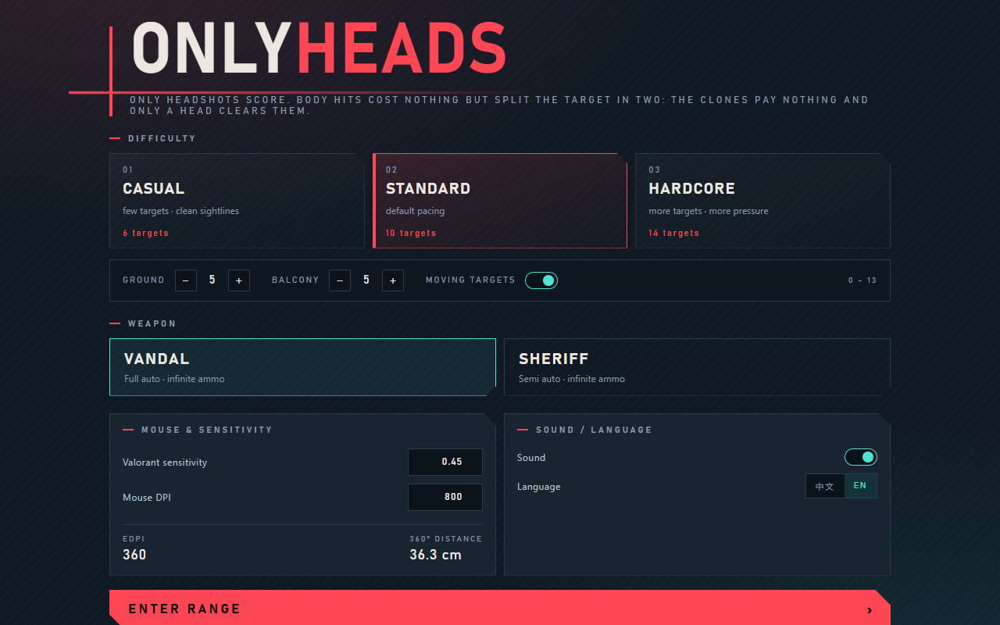
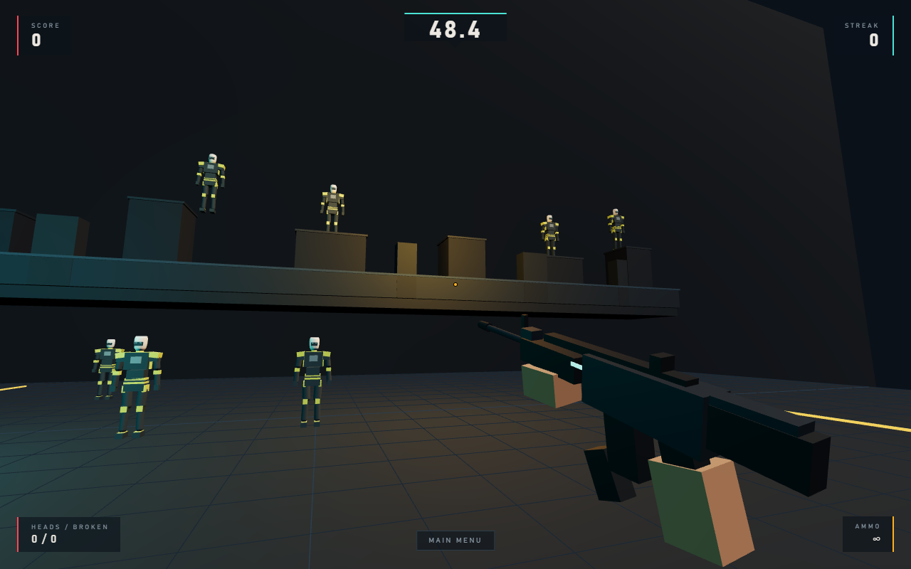

# OnlyHeads

一个 60 秒一局的网页练枪靶场:只爆头得分,打中身体按档位惩罚。靶场分两层,一层全身靶、二层只露头肩。

非官方练习工具,与 Riot Games 无关。

## 截图





## 运行

**Windows:双击 `start.bat`。** 首次运行会自动装依赖,之后每次启动都会自动打开浏览器。

也可以手动跑:

```bash
npm install
npm run dev
```

打开终端提示的地址(默认 http://localhost:5173)。

## 操作

- 点击画面进入靶场,指针锁定后开始
- 左键射击,**无限弹药,不需要换弹**
- WASD 移动,速度 6.75 m/s(与瓦洛兰特一致);按住 Shift 静步 3.375 m/s;**空格跳跃**
- 移动中开枪会散:站定 0° · 静步约 1.1° · 跑动 2.6°(松手后约 80ms 恢复精准)
- 狂徒后坐力:前几发向上爬(5 发累计约 2.5°),之后左右摆动;停火约 120ms 后视角回正
- Esc 暂停
- 灵敏度与瓦洛兰特 1:1:每鼠标计数 0.07° × 灵敏度
- 默认英文,菜单里可切换中文;选择会保存在本地

## 玩法

- **60 秒**,每层靶数可自己调(菜单里一层/二层各 0~13 个,选难度会套用预设),回合永远打满 60 秒
- **爆头 +100**,靶子立刻消失;头部永远一枪
- **打中身体 0 分**:原靶消失,左右各生成一个红色罚靶
- **红色罚靶**:爆头一枪倒;打身体要累计 **4 枪**;不给分,也不占你的分
- 空枪不扣分;连爆只被身体命中打断(连爆只用于显示)
- 靶子每 3.5~6.5 秒自己换到同层空位,被清掉后 0.6 秒补位
- **靶子是否移动**在菜单里开关;开启时每个靶子都会前后左右地游走

三档只是靶数预设,规则完全一致;移动是独立开关。

**排行榜**:菜单里填玩家名,每局结束自动上榜,保留分数最高的 20 条。数据存在浏览器本地(换名字就是换人),清缓存会清空。

## 脚本

```bash
npm run dev        # 开发服务器
npm run build      # 类型检查 + 生产构建
npm run preview    # 预览构建产物
npm run test       # 单元测试
npm run typecheck  # 仅类型检查
```

## 目录

```
src/
  game/     纯逻辑:配置、靶位、计分、命中判定、灵敏度
  engine/   Three.js 场景、输入、靶子、粒子、音频、回合
  ui/       React 界面:菜单、HUD、结算
  i18n/     中英文案
  storage/  本地记录
  __tests__ 单元测试
```

计分与命中都是纯函数,不依赖 DOM。

## 已知限制

- 桌面 Chrome / Edge 最佳;Firefox 原始输入不稳定;Safari 未验证
- 浏览器输入延迟高于原生游戏:手感接近,不会完全一致
- 机器人、枪械都是原创低多边形模型,只参考比例与持枪角度,不复制游戏资产
- 枪械目前用基础几何体拼装,细节和真实狂徒模型有差距
- 第一版没有新手演示、准星样式库、排行榜、桌面端
